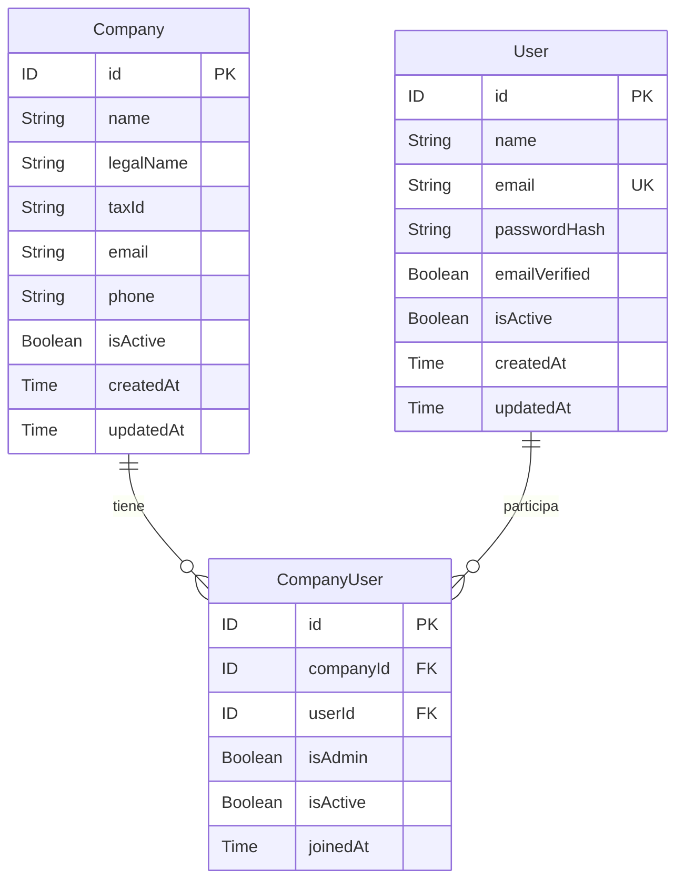

# Análisis de la actividad 3

Fuente: `session_1_2_actividad.pdf`, páginas 1–7. El alcance es la gestión de empresas (día 1) y de usuarios y administrador empresarial (día 2).

## Actores

| Actor | Responsabilidad |
|---|---|
| Administrador empresarial | Autenticarse, registrar, consultar y desactivar usuarios de su empresa. |
| Usuario | Autenticarse como cuenta asociada a una empresa. |
| Operador de instalación | Crear empresas y su primer administrador con la clave local de inicialización. Es una decisión técnica para el inicio del sistema. |

## Entidades y atributos

| Entidad | Atributos obligatorios | Atributos opcionales |
|---|---|---|
| Company | id: ID, name: String, isActive: Boolean, createdAt: Time, updatedAt: Time | legalName, taxId, email, phone: String |
| User | id: ID, name: String, email: String, emailVerified: Boolean, isActive: Boolean, createdAt: Time, updatedAt: Time | Ninguno |
| CompanyUser | id, companyId, userId: ID; isAdmin, isActive: Boolean; joinedAt: Time; company: Company; user: User | Ninguno |

User guarda además `passwordHash`, obligatorio e interno; no forma parte del tipo GraphQL. Los IDs y las fechas los genera el servidor. Los nombres no pueden estar vacíos. Los correos proporcionados deben ser válidos; el correo de User se normaliza y es único. Los booleanos empiezan en true salvo emailVerified e isAdmin de usuarios normales.

Los campos, tipos y nulabilidad públicos corresponden a las páginas 3–6 del PDF. La notación exacta y todos los inputs están en `schema.graphql`. `UpdateCompanyInput` exige sólo id: omitir un campo conserva su valor; null elimina un campo opcional y se rechaza en name e isActive.

## Relaciones y cardinalidades

Company 1:N CompanyUser: una empresa puede tener varios vínculos y cada vínculo pertenece a una sola empresa. User 1:N CompanyUser: una cuenta puede tener varios vínculos y cada vínculo corresponde a una sola cuenta. Juntas representan Company N:M User, permitiendo varias empresas por usuario sin colocar companyId en User.

Una empresa recién creada puede tener cero vínculos hasta registrar su administrador. La pareja companyId–userId no se repite. Cada empresa admite un único administrador principal.

## Reglas de negocio

1. Los datos de cada empresa se mantienen independientes.
2. Una empresa no puede tener dos administradores principales; lo impiden la aplicación y un índice único en la BD.
3. Sólo el administrador autenticado y activo de la empresa puede registrar o desactivar a sus usuarios.
4. No se registran correos de cuenta duplicados ni usuarios en empresas inexistentes o inactivas.
5. Las contraseñas se almacenan mediante hash y no se devuelven por GraphQL.
6. Crear User y CompanyUser es una sola transacción: si falla el vínculo, se revierte la cuenta.
7. La eliminación de empresas es lógica mediante deactivateCompany, conforme al esquema del PDF.
8. No se desactiva al administrador principal individualmente; puede desactivarse la empresa completa.

## Decisiones de implementación

El PDF fija entidades, esquema, aislamiento, administrador único, hash, validación de correo y casos de prueba. No fija framework, algoritmo de hash, formato del token ni mecanismo de inicialización: se usan FastAPI/Strawberry, SQLAlchemy/SQLite, Argon2id, JWT de 30 minutos y una clave local para inicializar.

Se limita name a 200 caracteres, legalName a 250, taxId y phone a 50; la contraseña admite 10–128 caracteres. Las fechas se exponen en UTC. El correo se normaliza a minúsculas. emailVerified empieza en false y no bloquea login porque no se solicita un flujo de verificación de correo.

Login requiere una cuenta activa con alguna membresía activa en una empresa activa. Una empresa inactiva bloquea la gestión de sus miembros; reactivarla conserva los estados individuales. Una membresía inactiva sigue visible para el administrador, pero no otorga permisos. Registrar una cuenta nunca reutiliza un correo existente.

## Distribución del equipo

Completar con nombres y responsabilidades reales antes de entregar. Esta tabla es una propuesta, no acredita participación.

| Integrante (nombre por completar) | Sección propuesta |
|---|---|
| 1 | Actores, entidades, atributos y reglas de negocio |
| 2 | Relaciones, cardinalidades y modelos de BD |
| 3 | CRUD de empresas y GraphQL del día 1 |
| 4 | Usuarios, administrador y autenticación del día 2 |
| 5 | Pruebas GraphQL y documentación de evidencias |

