# Evidencias reales — Unidad II, Actividad 3

**Autor: Enrique Zavala. Entrega individual.**

Las capturas se obtuvieron ejecutando operaciones en GraphiQL, en
`http://127.0.0.1:8007/graphql`, sobre la API y MySQL de Docker Compose.
No son simulaciones ni respuestas dibujadas. Cada captura tiene una explicación y,
salvo la primera consulta de roles, un archivo `.graphql` y el texto accesible
observado del resultado (`*-visible.txt`) junto a ella.

## Resultados verificados

- **41 pruebas aprobadas con MySQL 8.4.11:** [salida pytest](pytest-mysql.txt), [JUnit](pytest-mysql.xml), [operaciones y respuestas](graphql-mysql.json).
- **40 pruebas aprobadas con SQLite y una omitida:** [salida pytest](pytest-sqlite.txt), [JUnit](pytest-sqlite.xml), [operaciones y respuestas](graphql-sqlite.json). La omisión es únicamente la migración a MySQL, que sí pasó en MySQL.
- **7 verificaciones HTTP de las finanzas anteriores contra la API Docker:** [respuestas reales](smoke-finance.json).
- **Matriz inicial:** 4 roles, 10 permisos y 26 relaciones. [SELECT antes del rechazo](antes-rechazo.json), [después](despues-rechazo.json), [después de reiniciar](despues-reinicio.json).
- **Sin escritura al rechazar CONSULTA:** transactions tenía 21 filas antes del intento y 21 después. El movimiento aceptado de la captura 5 elevó previamente el conteo de 20 a 21.
- **Migración sin pérdida:** [comparación de todas las filas anteriores](migracion-verificada.json). Se corrigió la precisión MySQL a DATETIME(6) y se restituyeron los microsegundos desde el SQLite conservado; la comparación final de todos los campos fue exacta.
- **Login conservado:** [verificación estructural del método](login-sin-cambios.json). El token, el hash y su exclusión del esquema público también se prueban por HTTP.

Las respuestas de prueba ocultan passwords y tokens. La contraseña que se ve en la captura de administrador duplicado es un dato ficticio que nunca se registró. No se muestran las claves de inicialización ni contraseñas de MySQL.

## Capturas y regla demostrada

### 1. Catálogo de roles

Los cuatro códigos iniciales son ADMINISTRADOR, CONTADOR, CAPTURISTA y CONSULTA.

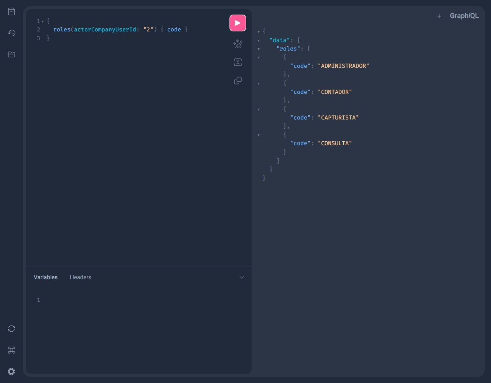

### 2. Catálogo de permisos

El servidor muestra los diez códigos definidos por el documento.

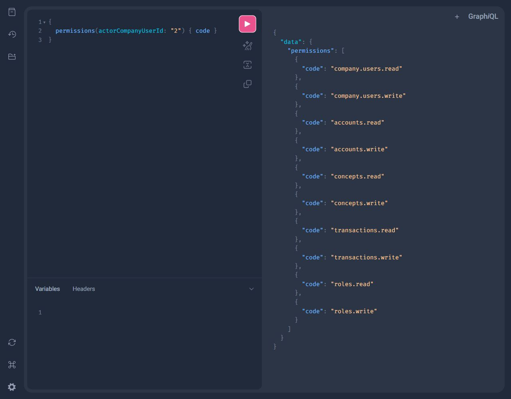

### 3. Permisos de CAPTURISTA

Incluye transactions.write y permisos de lectura de cuentas, conceptos y movimientos. No incluye accounts.write.

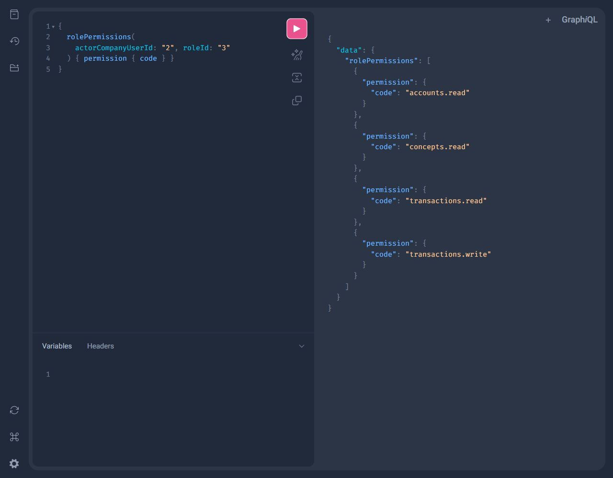

### 4. Permisos de CONSULTA

Todos sus permisos terminan en .read; ninguno permite escribir.

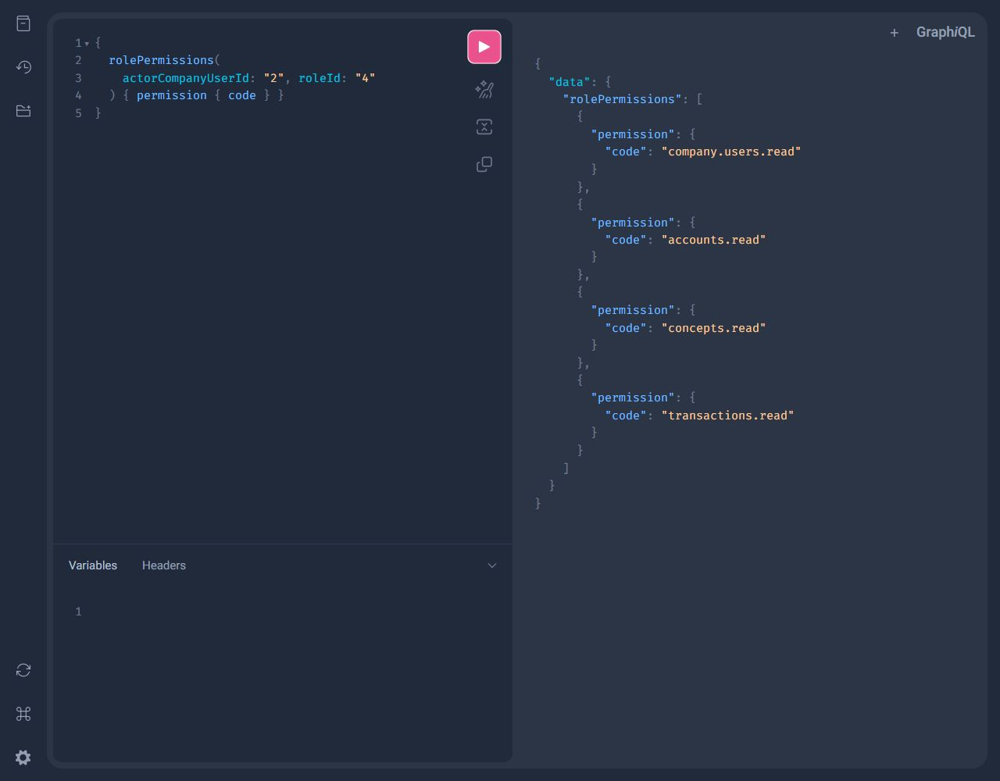

### 5. Movimiento aceptado

CAPTURISTA registra 13.37. La respuesta devuelve el movimiento 21 y el usuario responsable 4.

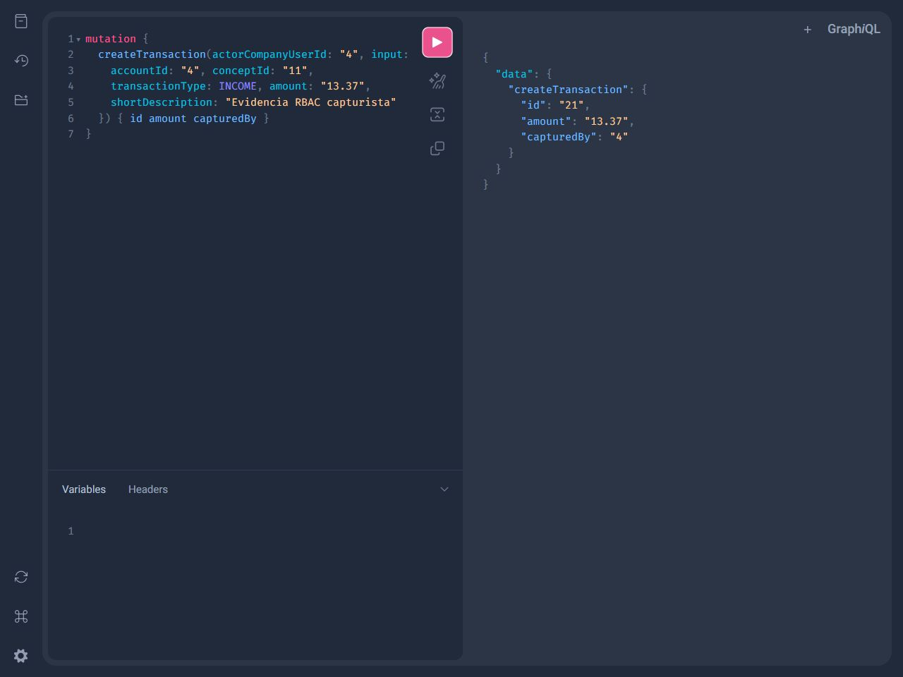

### 6. Movimiento rechazado

CONSULTA recibe errors con FORBIDDEN por carecer de transactions.write. Los SELECT antes y después confirman que el intento no agregó filas.

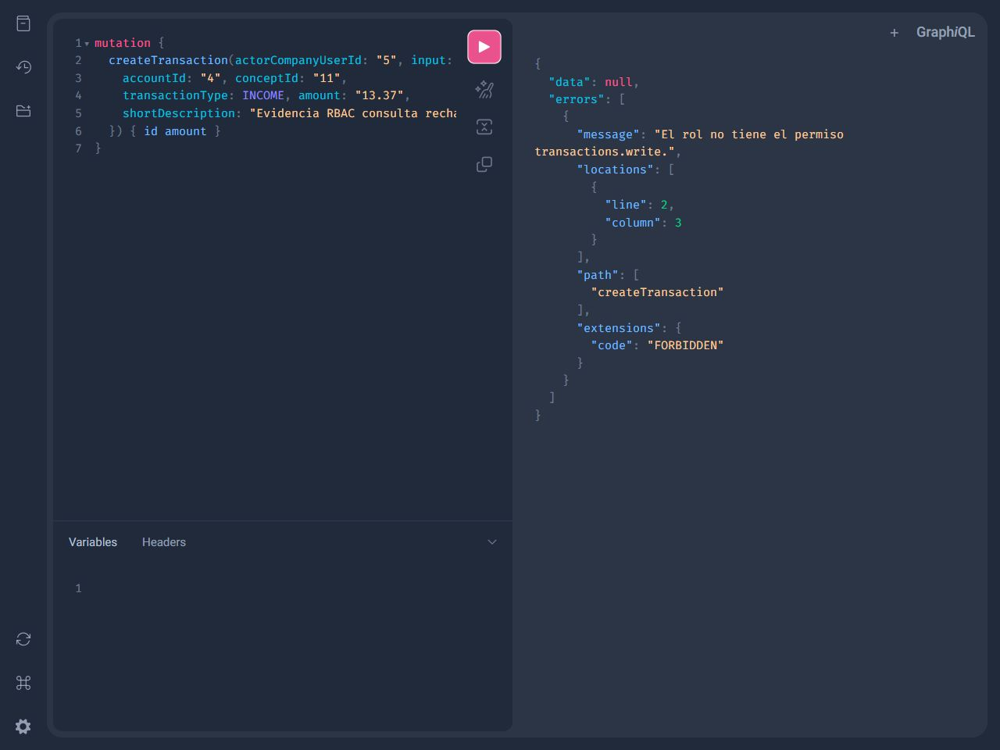

### 7. Cuenta creada por CONTADOR

CONTADOR tiene accounts.write y crea correctamente una cuenta.

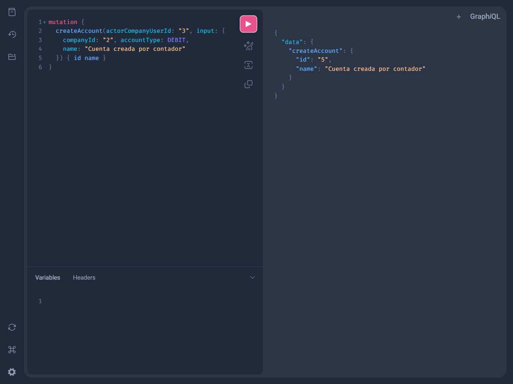

### 8. Cuenta rechazada para CAPTURISTA

CAPTURISTA carece de accounts.write y la mutación responde FORBIDDEN.

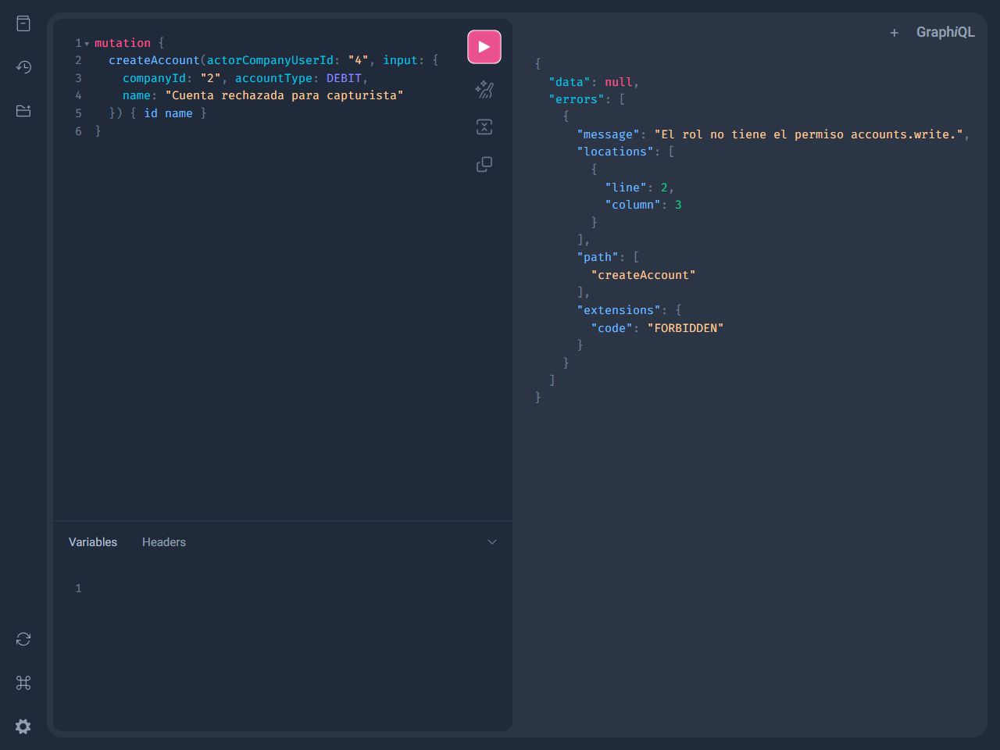

### 9. Roles después de reiniciar

Se ejecutó `docker compose --env-file .env.docker restart api`. La consulta posterior conserva los cuatro códigos, sin duplicarlos; el SELECT conserva también diez permisos y 26 relaciones.

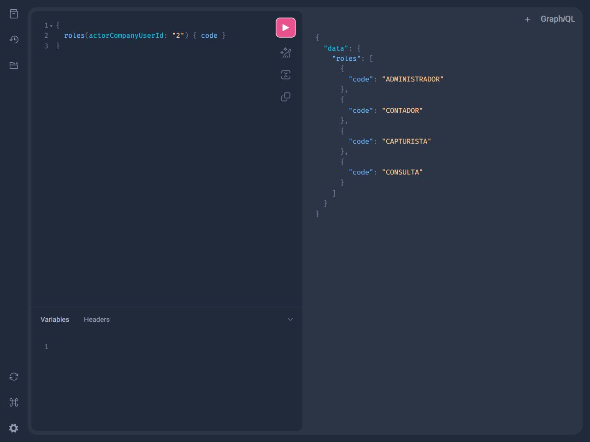

### 10. Cambio de CAPTURISTA a CONTADOR

assignRole cambia la membresía 4 a CONTADOR; la asignación anterior queda inactiva. La prueba automatizada también verifica un único rol activo ante cambios concurrentes.

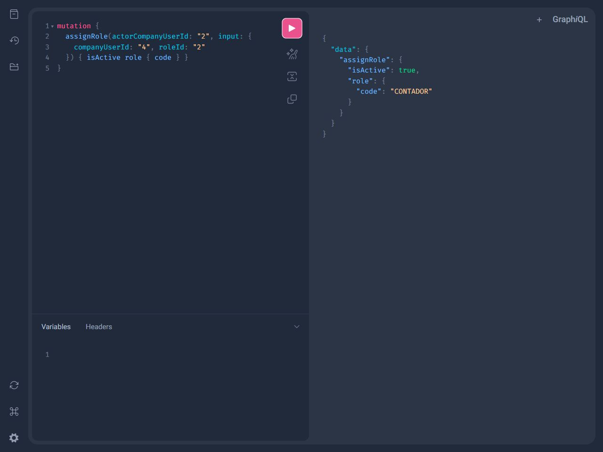

### 11. Cuenta después del cambio

La misma membresía 4 ahora puede crear una cuenta porque recibió los permisos de CONTADOR.

### 12. Administrador principal duplicado

createCompanyAdmin mantiene la regla de un administrador principal por empresa y rechaza el segundo con CONFLICT.

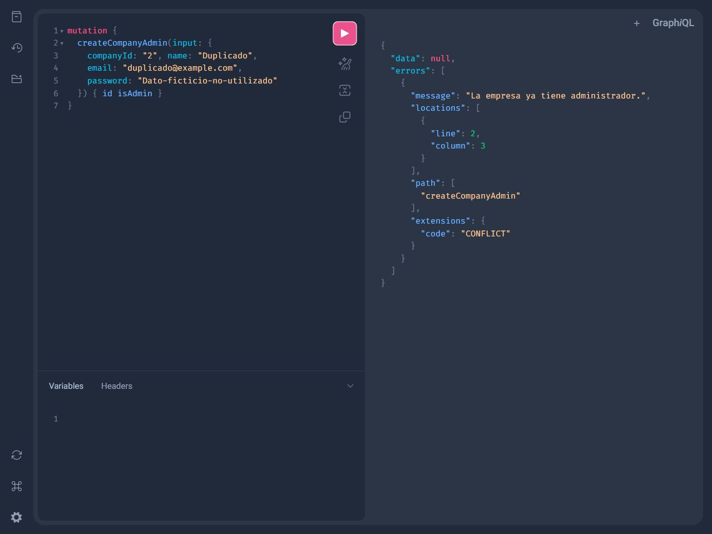

Después de estas capturas se devolvió explícitamente la membresía demo 4 a CAPTURISTA para facilitar su repetición: [operación y respuesta](restauracion-demo.json). Ese cambio es una acción autorizada, no una restauración automática al arrancar.

## Correspondencia con requisitos

| Requisito | Implementación | Evidencia |
|---|---|---|
| Continuar el proyecto y conservar entidades anteriores | Cambios sobre el mismo app/, commit anterior y copia SQLite preservados | migracion-verificada.json; regresión financiera |
| Role y Permission como catálogos globales | access_models.py y access_schema.py | Capturas 1–2; comparación del contrato |
| Códigos únicos y desactivación lógica | Restricciones UNIQUE; deactivateRole | test_catalog_crud_codes_filters_and_no_physical_delete |
| Matriz exacta | access.py, MATRIX | Capturas 3–4; SELECT de MySQL; test_exact_matrix_and_membership_roles |
| Parejas sin duplicación y reactivación | UNIQUE(role_id,permission_id); reutilización de fila | test_restart_idempotency_and_preserves_revocations |
| Reinicio idempotente sin restaurar revocaciones | Cuenta relaciones activas e inactivas | Captura 9; test_all_revoked_role_not_restored_at_startup |
| Rol en CompanyUser, no User | company_user_roles con FK a membresía | Modelos y esquema; asignación SQL |
| Un rol activo y cambio atómico | Índice único activo y transacción | Capturas 10–11; test_concurrent_role_changes_leave_one_active |
| Transición sin privilegios administrativos automáticos | Membresías antiguas sin historial reciben CONSULTA | test_previous_membership_transition_is_consulta_not_admin |
| Administrador principal conservado | Bootstrap existente, isAdmin=true, rol ADMINISTRADOR en una transacción | Captura 12; test_second_admin_is_rejected_without_orphan_user |
| Función central y comprobación antes del commit | exigir_permiso y check_before_commit | test_precommit_authorization_rolls_back_self_revocation |
| Sin bypass isAdmin | isAdmin solo protege la unicidad del principal | test_is_admin_is_not_a_permission_bypass |
| Operaciones financieras y de miembros protegidas | Permisos .read/.write por resolver | Capturas 5–8; test_read_permissions_and_member_write_permissions |
| Sin cambios parciales al rechazar | Transacción por resolver | Conteo 21→21; pruebas de rollback y rechazo |
| Aislamiento empresarial | Empresa de la membresía actora | test_cross_company_resources_and_memberships |
| Estados inactivos no autorizan | Se comprueban los seis eslabones de la cadena | test_inactive_nodes_never_authorize, seis casos |
| Login, hash y User conservados | Método login sin cambios; User sin passwordHash | login-sin-cambios.json; prueba HTTP |
| Reglas financieras anteriores | Monto positivo, Decimal exacto, tipo y relaciones válidos | test_finance.py; smoke-finance.json |
| Contrato GraphQL del documento | Tipos e inputs exactos, argumento académico actorCompanyUserId | test_complete_contract_from_three_pdfs |
| MySQL y Docker funcionando | MySQL 8.4.11, API Linux en Docker Compose | SELECT VERSION; suite MySQL; capturas del endpoint Docker |
| Evidencias, consultas SQL y ejemplos | Este índice, comprobacion-mysql.sql, roles-operaciones.md | Archivos incluidos en la entrega |

El mecanismo académico permite seleccionar actorCompanyUserId y no comprueba su pertenencia al token: esa vinculación corresponde a la siguiente unidad. Se documenta expresamente en el README. El aviso de deprecación de Starlette/AnyIO no afectó los resultados.
