# Evidencias - Unidad II, Actividad 4

**Enrique Zavala. 14 de octubre de 2026.**

Fuente: `unidad2_actividad_4.pdf`, ocho páginas, suministrado por el autor. Se continuó la API existente y se completó primero la base de roles que aún no tenía.

## Ejecuciones reales

- Regresión y autorización en bases temporales SQLite: **57 pruebas aprobadas** ([registro](evidencias/roles/sqlite-pytest.txt)).
- Autorización contra MySQL aislado: **15 pruebas aprobadas** ([registro](evidencias/roles/mysql-pytest.txt)).
- **28 operaciones ejecutadas en GraphiQL**, con sus respuestas HTTP y comprobaciones SQL ([JSON](evidencias/roles/demostracion.json)).
- MySQL **8.4.11**. Reinicio real de la API: **4 roles y 10 permisos**, sin duplicados ([registro](evidencias/roles/reinicio-mysql.json)).
- `pip check`: sin dependencias rotas. Existe un aviso de deprecación de Starlette/AnyIO; no hubo fallos de pruebas.
- [SELECT final](roles-select.sql) y [resultado TSV](evidencias/roles/role_permissions-final.tsv).
- [Reporte PDF con capturas](../output/pdf/Unidad2_Actividad4_Evidencias.pdf).

Las capturas muestran respuestas reales de la API en GraphiQL. El capturador no simula ni sustituye las respuestas. Los tokens quedan ocultos en la pestaña Headers. Las verificaciones SQL usan conexiones independientes después de cada operación.

## Correspondencia con los requisitos

| Requisito | Implementación y evidencia |
|---|---|
| Cuatro roles y diez permisos | role_models.py, role_catalog.py, catálogos y matriz inicial |
| Permisos de puesto, no de usuario | role_permissions y exigir_permiso en role_service.py |
| Dos capturistas reciben el mismo cambio | María y José rechazados, aceptados y rechazados después de revocar |
| Quitar conserva la fila | Mismo ID y isActive=false; SELECT final incluye las parejas inactivas |
| Pedro cambia de puesto | assignRole, movimiento antes/después e historial con un único rol activo |
| Contador y Consulta conservan sus listas | Comparación de conjuntos antes/después; Luis crea cuenta |
| Solo roles.write cambia listas | Intento de José rechazado; misma operación de Ana aceptada |
| Rechazo no guarda filas | Conteos antes/después en el JSON y pruebas HTTP con verificación SQL |
| Separación por empresa y actor | Pruebas de roles de otra empresa y suplantación del actor contra JWT |
| Reinicio sin duplicar ni reactivar permisos | Reinicio real y prueba de configuración revocada persistente |
| Matriz final igual al documento | 26 parejas activas originales y dos parejas de demostración inactivas |

## Capturas y regla demostrada

### 00 Preparar el puesto inicial de Pedro

**Actor: Ana.** La demostración comienza con Pedro como CONSULTA.

Esperado y obtenido: **OK**.

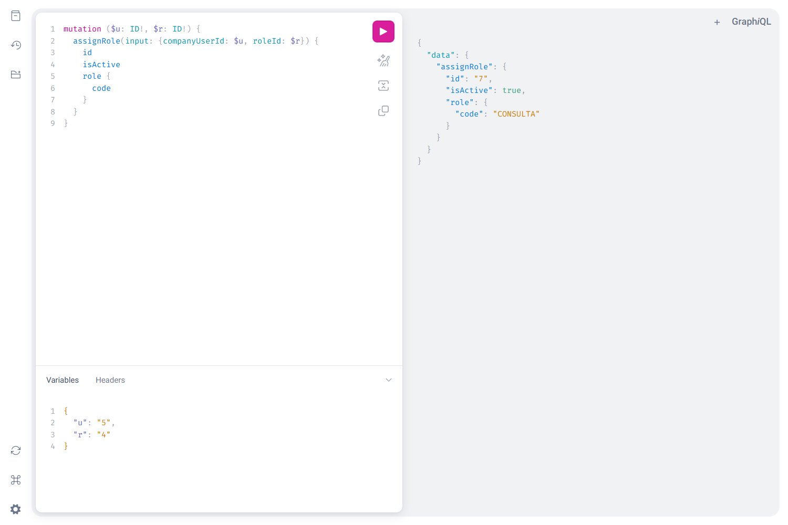

### 01 Catálogos

**Actor: Ana.** La empresa tiene cuatro roles y diez permisos.

Esperado y obtenido: **OK**.

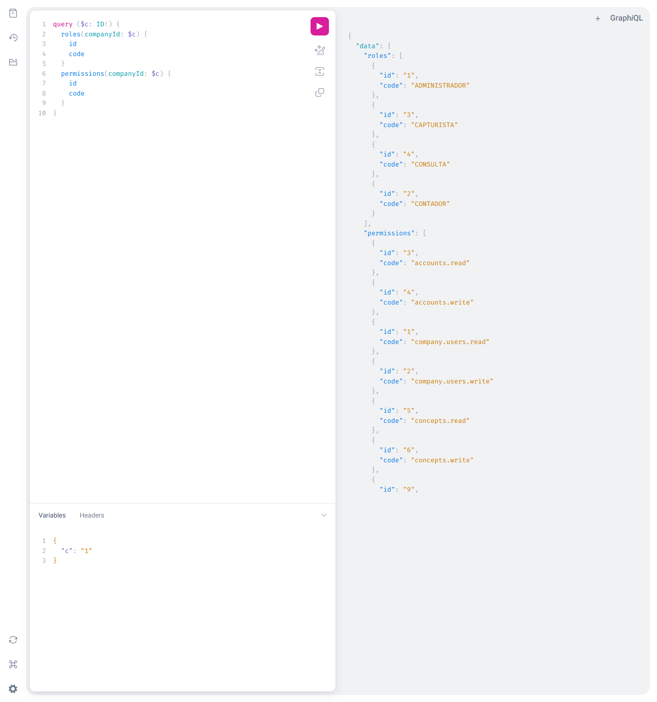

### 02 Configuración inicial ADMINISTRADOR

**Actor: Ana.** Lista vigente del rol ADMINISTRADOR.

Esperado y obtenido: **OK**.

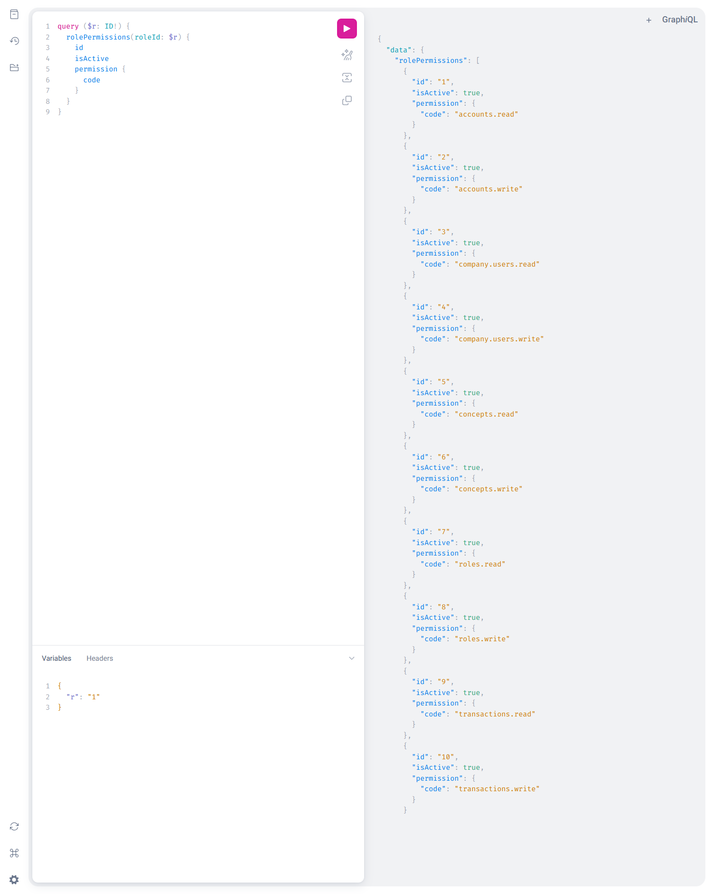

### 02 Configuración inicial CONTADOR

**Actor: Ana.** Lista vigente del rol CONTADOR.

Esperado y obtenido: **OK**.

### 02 Configuración inicial CAPTURISTA

**Actor: Ana.** Lista vigente del rol CAPTURISTA.

Esperado y obtenido: **OK**.

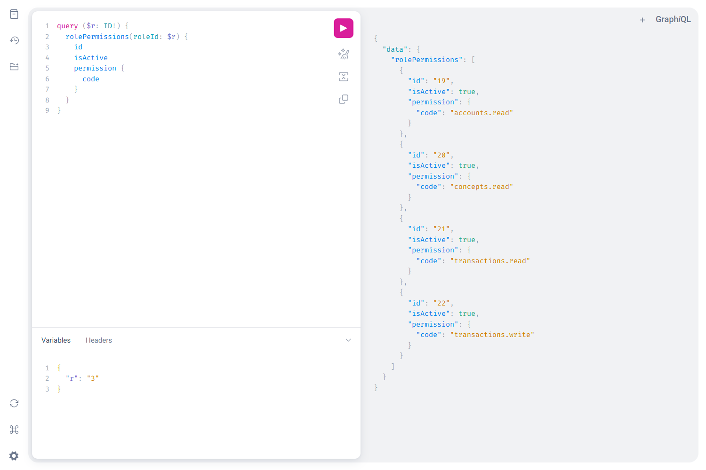

### 02 Configuración inicial CONSULTA

**Actor: Ana.** Lista vigente del rol CONSULTA.

Esperado y obtenido: **OK**.

### 03 Antes de conceder Cuenta de María

**Actor: María.** El permiso accounts.write se decide por el rol vigente; un rechazo no inserta filas.

Esperado y obtenido: **FORBIDDEN**.

Comprobación independiente de almacenamiento: `{"accounts_before": 7, "accounts_after": 7}`.

### 03 Antes de conceder Cuenta de José

**Actor: José.** El permiso accounts.write se decide por el rol vigente; un rechazo no inserta filas.

Esperado y obtenido: **FORBIDDEN**.

Comprobación independiente de almacenamiento: `{"accounts_before": 7, "accounts_after": 7}`.

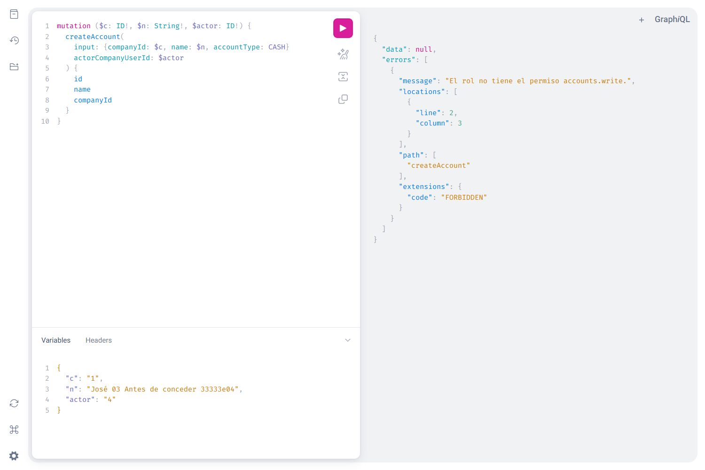

### 04 Ana concede accounts.write

**Actor: Ana.** Un cambio en CAPTURISTA beneficia a sus dos integrantes.

Esperado y obtenido: **OK**.

### 05 Con permiso Cuenta de María

**Actor: María.** El permiso accounts.write se decide por el rol vigente; un rechazo no inserta filas.

Esperado y obtenido: **OK**.

Comprobación independiente de almacenamiento: `{"accounts_before": 7, "accounts_after": 8}`.

### 05 Con permiso Cuenta de José

**Actor: José.** El permiso accounts.write se decide por el rol vigente; un rechazo no inserta filas.

Esperado y obtenido: **OK**.

Comprobación independiente de almacenamiento: `{"accounts_before": 8, "accounts_after": 9}`.

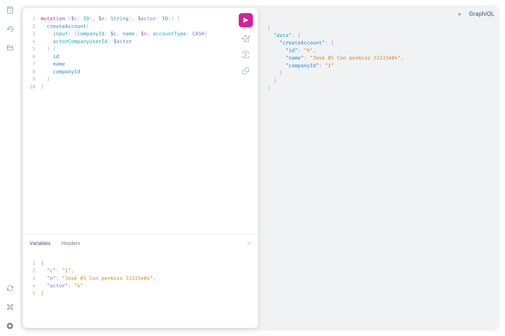

### 06 Ana quita accounts.write

**Actor: Ana.** Quitar un permiso desactiva la pareja y conserva el ID.

Esperado y obtenido: **OK**.

Comprobación independiente de almacenamiento: `{"role_permission_id": 27, "is_active": false, "row_preserved": true}`.

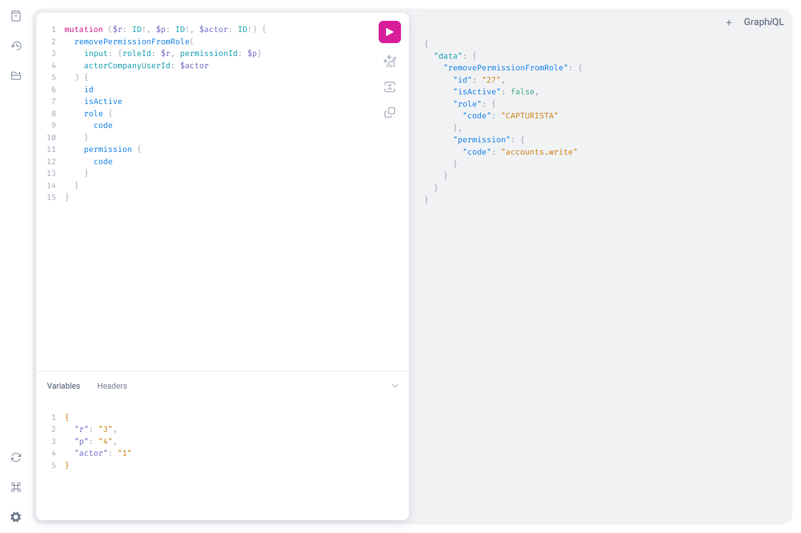

### 07 Tras quitar permiso Cuenta de María

**Actor: María.** El permiso accounts.write se decide por el rol vigente; un rechazo no inserta filas.

Esperado y obtenido: **FORBIDDEN**.

Comprobación independiente de almacenamiento: `{"accounts_before": 9, "accounts_after": 9}`.

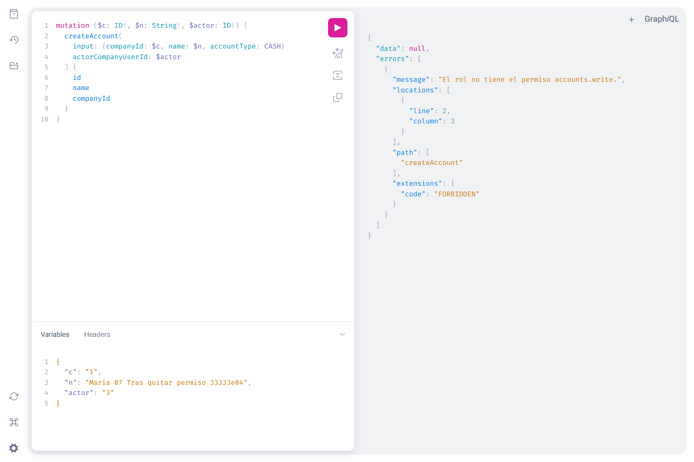

### 07 Tras quitar permiso Cuenta de José

**Actor: José.** El permiso accounts.write se decide por el rol vigente; un rechazo no inserta filas.

Esperado y obtenido: **FORBIDDEN**.

Comprobación independiente de almacenamiento: `{"accounts_before": 9, "accounts_after": 9}`.

### 08 Pedro como CONSULTA

**Actor: Pedro.** CONSULTA no tiene transactions.write; el rechazo no crea movimientos.

Esperado y obtenido: **FORBIDDEN**.

Comprobación independiente de almacenamiento: `{"transactions_before": 2, "transactions_after": 2}`.

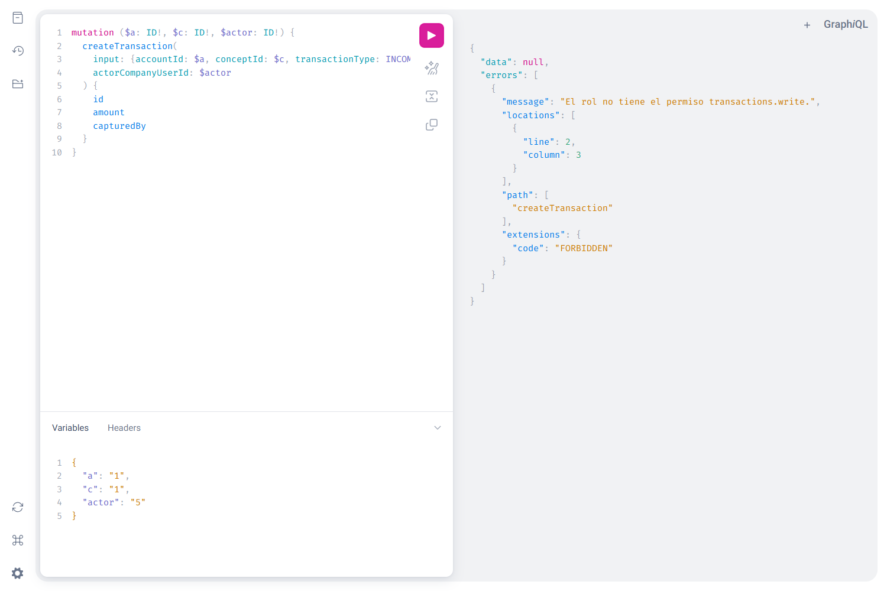

### 09 Ana cambia el puesto de Pedro

**Actor: Ana.** assignRole deja un solo rol activo y conserva el anterior inactivo.

Esperado y obtenido: **OK**.

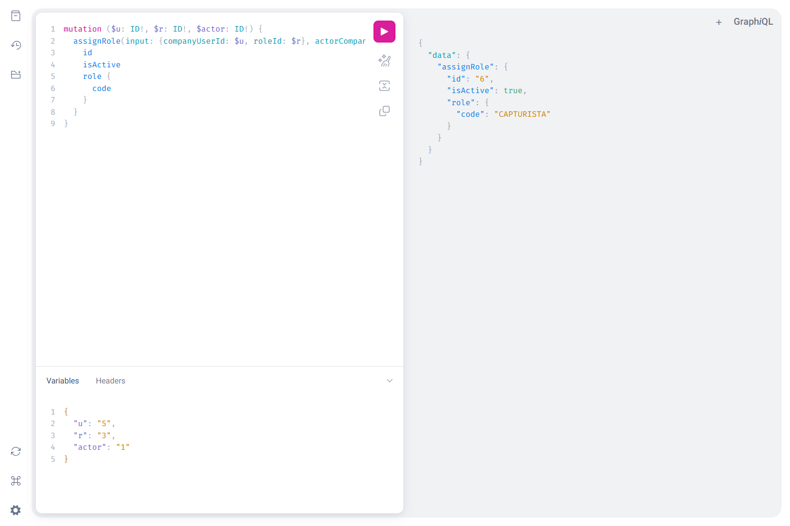

### 10 Pedro como CAPTURISTA

**Actor: Pedro.** El mismo token recibe los permisos del nuevo rol.

Esperado y obtenido: **OK**.

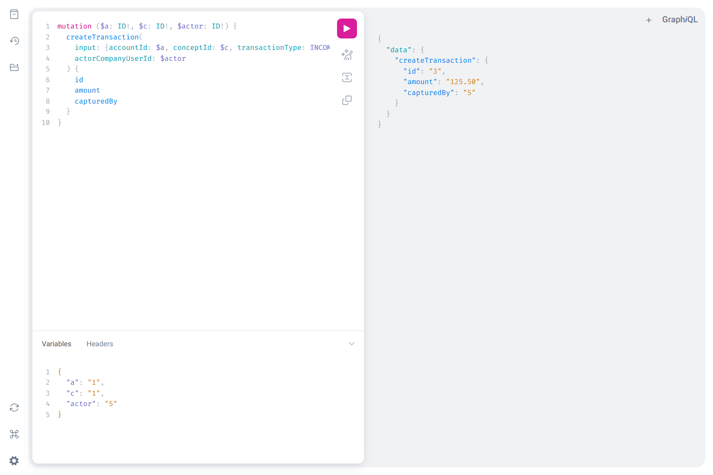

### 11 Historial de Pedro

**Actor: Ana.** Pedro tiene CAPTURISTA activo y CONSULTA inactivo.

Esperado y obtenido: **OK**.

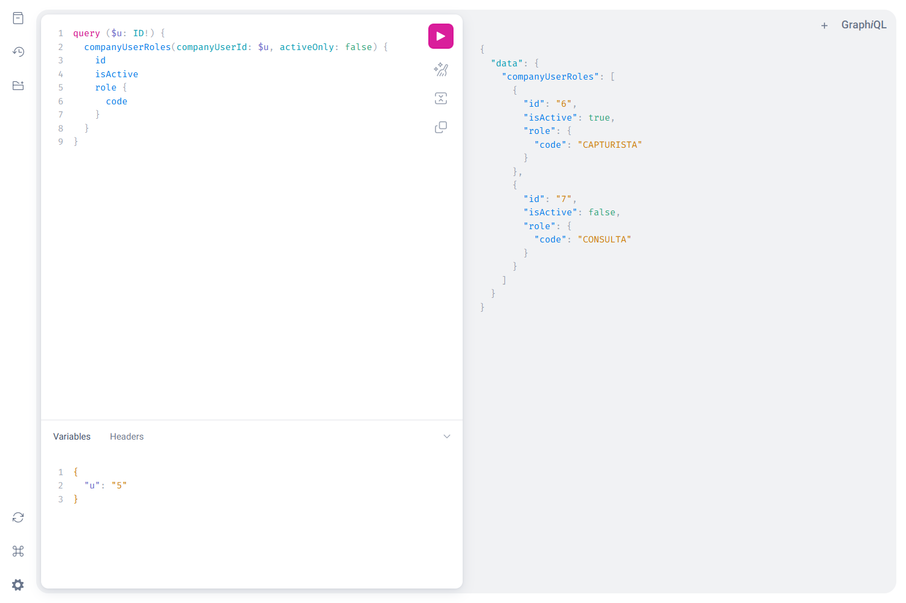

### 12 Contador sin cambios

**Actor: Ana.** Lista vigente del rol CONTADOR.

Esperado y obtenido: **OK**.

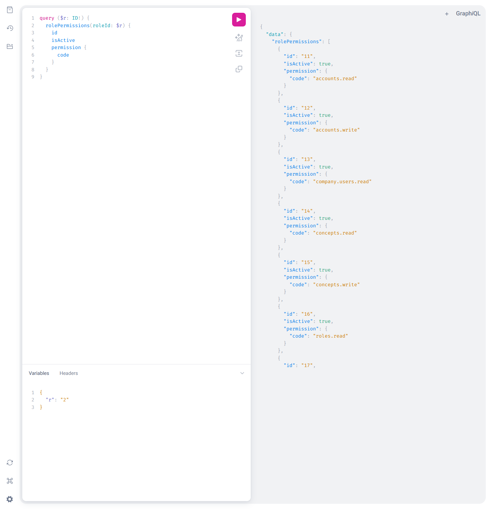

### 13 Consulta sin cambios

**Actor: Ana.** Lista vigente del rol CONSULTA.

Esperado y obtenido: **OK**.

### 14 Contador conserva escritura Cuenta de Luis

**Actor: Luis.** El permiso accounts.write se decide por el rol vigente; un rechazo no inserta filas.

Esperado y obtenido: **OK**.

Comprobación independiente de almacenamiento: `{"accounts_before": 9, "accounts_after": 10}`.

### 15 José intenta configurar permisos

**Actor: José.** Sin roles.write no se cambia la lista ni se inserta la pareja.

Esperado y obtenido: **FORBIDDEN**.

Comprobación independiente de almacenamiento: `{"role_permissions_before": 28, "role_permissions_after": 28}`.

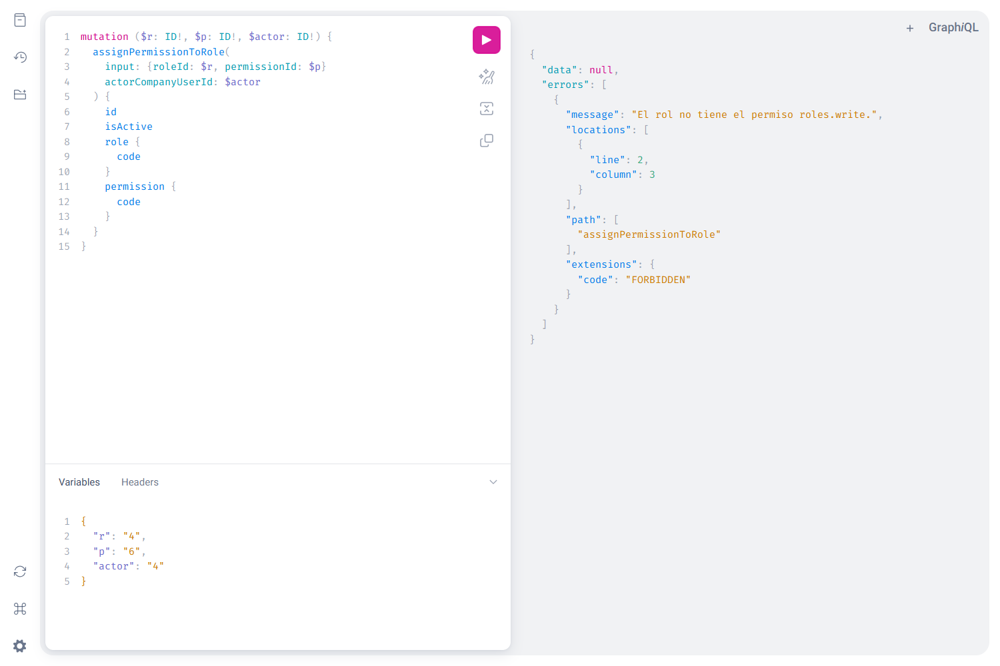

### 16 Ana agrega concepts.write a CONSULTA

**Actor: Ana.** Con roles.write la misma operación sí se permite.

Esperado y obtenido: **OK**.

### 17 Ana restaura CONSULTA

**Actor: Ana.** La pareja queda inactiva y CONSULTA vuelve a ser de lectura.

Esperado y obtenido: **OK**.

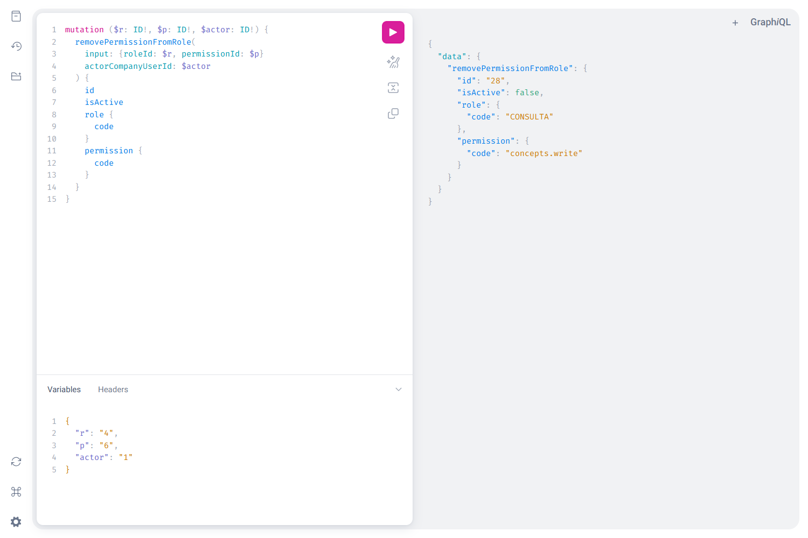

### 18 Matriz final ADMINISTRADOR

**Actor: Ana.** Lista vigente del rol ADMINISTRADOR.

Esperado y obtenido: **OK**.

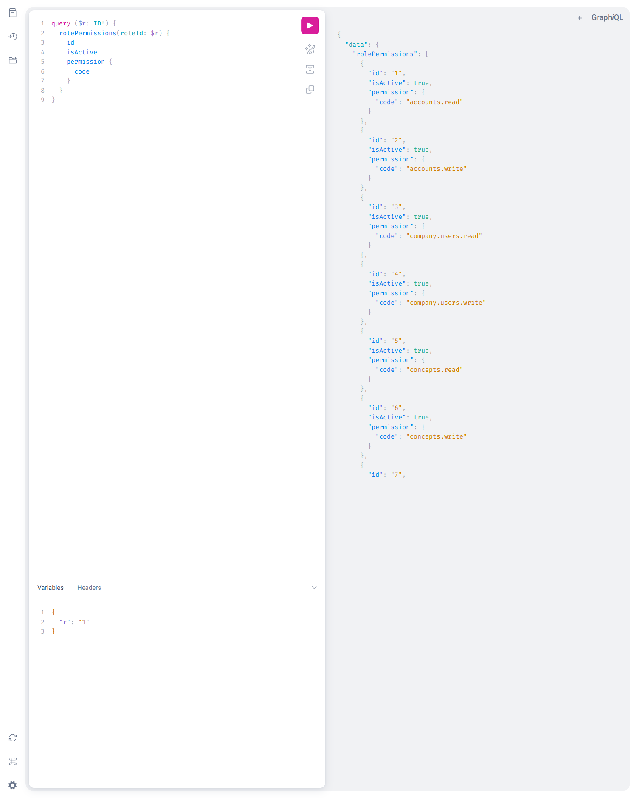

### 18 Matriz final CONTADOR

**Actor: Ana.** Lista vigente del rol CONTADOR.

Esperado y obtenido: **OK**.

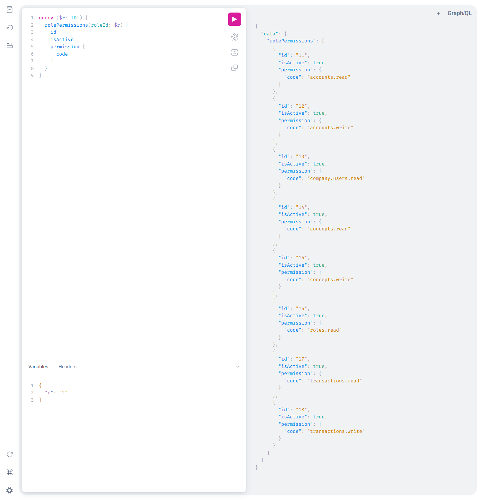

### 18 Matriz final CAPTURISTA

**Actor: Ana.** Lista vigente del rol CAPTURISTA.

Esperado y obtenido: **OK**.

### 18 Matriz final CONSULTA

**Actor: Ana.** Lista vigente del rol CONSULTA.

Esperado y obtenido: **OK**.

